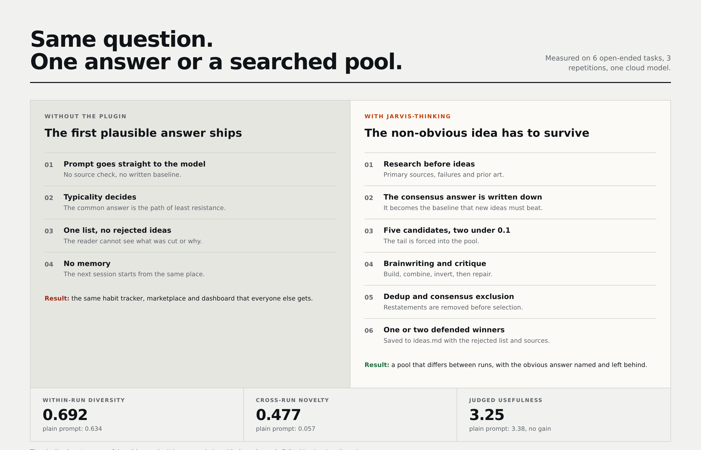
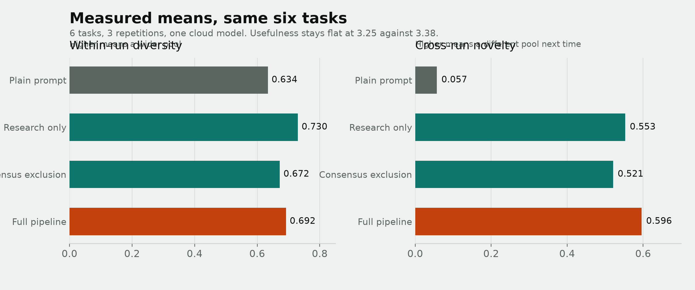

# Diagrams

Two images. One shows what changes, one shows what the change measured.

## Why it is different

The left side is the default path: one pass, the most common answer, no record. The right side is the pipeline: research first, the consensus answer written down as a baseline, five candidates with at least two below 0.1 probability, brainwriting, critique, deduplication against `ideas.md`, then one or two defended winners. The rejected list is part of the output.

Source: `docs/diagrams/html/before-after.html`. Regenerate with `python3 docs/diagrams/render_html.py`.

## What it measured

Means across six tasks and three repetitions. Diversity is the mean pairwise embedding distance inside a run. Novelty is the distance from the plain-prompt pool. Research and the full pipeline move both. Judged usefulness does not move (3.25 against 3.38), and the table in `docs/results.md` says so.

Source: `docs/diagrams/make_diagrams.py`. Regenerate with `python3 docs/diagrams/make_diagrams.py`.
